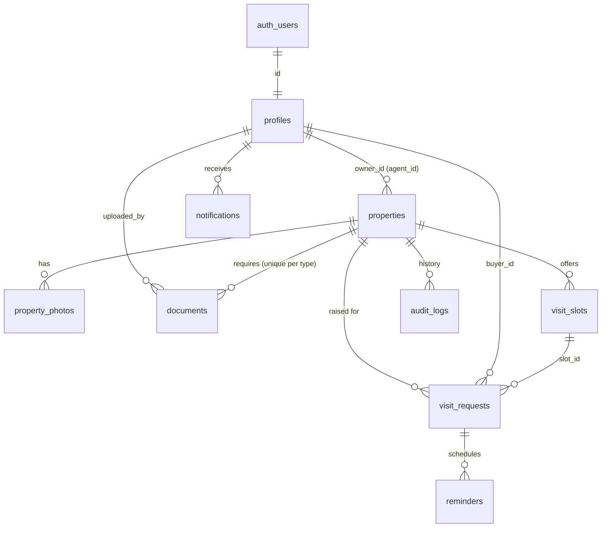

# REMS — Real Estate Management System (Release 1.0)

Sardar Patel Institute of Technology · Vedant Mehta (2024300138) · Dharmil Mehta (2024300135)

Two modules are implemented **end to end** — React UI → Supabase (Auth, PostgreSQL, Storage, RLS) → UI:

1. **Property Listing Management** — Draft → verification → public search → withdraw, with an administrator review console.
2. **Site Visit Scheduling & Appointment Management** — availability slots, visit requests, confirm / decline / propose another time, reschedule, cancel, notifications, 24-hour reminders, no double-booking.

Wishlist and Compare are outside the two modules and stay browser-local (`localStorage`). Messaging and payments are out of scope.

---

## 1. Architecture

```
 Browser (React 19 + TanStack Start/Router + Tailwind + shadcn/ui)
   │  src/lib/supabase.ts   ← the ONLY place that talks to Supabase (public anon key only)
   │  src/lib/rems/api.ts   ← data-service layer (one function per operation)
   │  src/lib/rems/auth.tsx ← Supabase Auth: session restore, sign-in/up/out, password reset, active role
   ▼
 Supabase
   ├─ Auth      email + password; a trigger creates the public.profiles row
   ├─ PostgREST RPC  → SECURITY DEFINER Postgres functions (all business rules + audit trail)
   ├─ Storage   property-photos (public bucket) · property-documents (PRIVATE bucket, signed URLs)
   └─ PostgreSQL  tables + constraints + RLS (read) — API roles have NO write grants on tables
```

**Design decision:** the browser can *read* through RLS policies, but it can **never write to a table directly**. Every write goes through a database function that authenticates with `auth.uid()` (never a user id from the browser), validates the rules, writes the audit row and raises an HTTP-mapped error (`PT401/403/404/409/422`). That is what stops "approve my own listing by editing a request", role escalation, ownership changes and appointment-rule bypasses. Direct `INSERT/UPDATE/DELETE` attempts are tested and return `42501` (permission denied).

No separate Express server and no Edge Function are needed: everything privileged runs inside Postgres. The service-role key is used only by `scripts/seed-storage.mjs` on your own machine and is never referenced by `src/`.

## 2. Setup (real Supabase project)

1. Create a project at supabase.com.
2. **Schema** — easiest: paste `supabase/setup_all.sql` into the SQL Editor and Run (it is the 9 migration files merged, tested on a clean database). Or run the files in `supabase/migrations/` **in filename order** (SQL editor, or `supabase link` + `supabase db push`).
   Migration 7 creates the two storage buckets and their policies; migration 8 schedules reminders with `pg_cron` if the extension is available (enable it under *Database → Extensions*; otherwise reminders are delivered lazily, see §8).
3. **Demo data (optional, demo projects only)** — run `supabase/seed.sql`. It creates five demo accounts that all use the password `Demo@1234`, sample listings and visit slots. **Do not run it on a real production project.**
4. **Seed documents' files (optional)** — so "View file" works for the seeded documents:
   `SUPABASE_URL=… SUPABASE_SERVICE_ROLE_KEY=… npm run seed:storage` (run on your own machine; never commit the key).
5. **Auth settings** (Authentication → URL Configuration): Site URL = the URL `npm run dev` prints; add `<that URL>/reset-password` to Redirect URLs. Email provider on. *Confirm email* off is fine for a demo (sign-up logs straight in); if you turn it on the app tells the user to check their email and you must configure SMTP.
6. **Environment** — copy `.env.example` to `.env.local` and fill `VITE_SUPABASE_URL` and `VITE_SUPABASE_ANON_KEY` (Project Settings → API). For the demo login buttons set `VITE_SHOW_DEMO_ACCOUNTS=true` and `VITE_DEMO_PASSWORD=Demo@1234`; leave them unset otherwise so no password ever reaches the bundle.
7. `npm install && npm run dev`.

| Demo account | Roles | Use it to |
|---|---|---|
| vedant@rems.demo | seller, buyer | list a property, publish slots, answer visit requests |
| dharmil@rems.demo | buyer, seller | request site visits |
| priya.agent@rems.demo | agent | list on behalf of an owner (needs the owner's confirmation) |
| admin@rems.demo | admin | verify documents, approve / reject listings, audit log, rules |
| rohan@rems.demo | seller | second owner |

Administrators can **never** be created from the browser (the sign-up trigger only grants buyer / seller / agent); `seed.sql`, run by the project owner, is how the demo admin exists.

## 3. Database (PostgreSQL)

Baseline = Experiment 3 UML (`User`, `Property`, `Document`, `VisitRequest`). Added only what the two modules need: `property_photos`, `visit_slots`, `notifications`, `reminders`, `audit_logs`, `app_settings`. `Message` and `Payment` are not implemented.



Primary keys are UUIDs (`visit_requests` also has a human-friendly `request_no` → "VR-12"). Foreign keys, timestamps, `CHECK`s and indexes are in `20261016000001_core_schema.sql`. Rules the **database itself** enforces regardless of any code path:

| Rule | Mechanism |
|---|---|
| A listing past Draft must be complete | `CHECK complete_when_submitted` |
| Same physical property can't be live twice (so never Sale **and** Rent) | partial unique index `properties_one_live_listing` on `(address, city)` where status is Active / Under Negotiation |
| Slots for a property can't overlap | `EXCLUDE USING gist` on `(property_id, tstzrange)` |
| **No double booking** — a slot is Confirmed at most once | partial unique index `visit_requests_one_confirmed_per_slot` |
| One live request per buyer per slot | partial unique index |
| Document type unique per property; PDF/JPEG/PNG ≤ 15 MB; rejection needs a reason ≥ 5 chars | `UNIQUE`, `CHECK`s |
| Audit log is append-only (even for the DB owner) | triggers on UPDATE / DELETE / TRUNCATE |

### Migrations (`supabase/migrations/`)

| # | File | Contents |
|---|---|---|
| 1 | `…000001_core_schema.sql` | enums, tables, constraints, indexes |
| 2 | `…000002_helpers_triggers.sql` | error helper, auth→profile trigger, permission helpers, audit/notify writers, `update_my_profile` |
| 3 | `…000003_rls.sql` | RLS on every table; revokes all write grants |
| 4 | `…000004_listing_functions.sql` | Module 1 write operations + admin verification |
| 5 | `…000005_listing_reads.sql` | public search, detail, dashboards, admin console reads |
| 6 | `…000006_visit_functions.sql` | Module 2 operations, reminders, notifications |
| 7 | `…000007_storage.sql` | buckets + Storage RLS policies |
| 8 | `…000008_grants_and_cron.sql` | which roles may call which functions; `pg_cron` schedule |
| 9 | `…000009_client_support.sql` | `my_profile()`, `get_settings()` |

## 4. Row Level Security & Storage policies

All tables have RLS enabled. API roles (`anon`, `authenticated`) hold **SELECT only**, via these policies:

| Table | Who can read |
|---|---|
| `properties` | everyone: Active / Under Negotiation; owner & agent: own; admin: all except Drafts |
| `property_photos` | follows `properties` visibility |
| `documents` | owner / authorised agent; admin (not for their own listing) |
| `visit_slots` | signed-in users: open slots of Active listings; managers: their slots |
| `visit_requests` | the buyer; the property's owner / authorised agent |
| `notifications` | the recipient only |
| `audit_logs` | admin; managers of that property; buyer for their own visits |
| `profiles` | self; admin |
| `reminders` | nobody (server-side only) |

Storage (`storage.objects`): **photos** — anyone can view; only the owner / authorised agent can upload / replace / delete, only while the listing is editable, max 10 per listing. **documents (private)** — only owner / authorised agent / admin can read (the browser gets 2-minute signed URLs); only the owner / authorised agent can upload, only to `<property id>/<doc type>/…`, and not while a listing is Pending Verification. File size and type are re-checked from `storage.objects.metadata` when the file is registered, never trusted from the client.

## 5. API surface (what is actually implemented)

There is no hand-written REST server. Operations are Postgres functions exposed by Supabase as `POST /rest/v1/rpc/<name>`; Auth and Storage use Supabase's own endpoints. Errors map to HTTP: `PT401/403/404/409/422` → 401/403/404/409/422, `42501` → 403.

**Public (anon):** `search_properties`, `get_property`, `get_properties_by_ids`, `get_settings`
**Account:** `my_profile`, `update_my_profile`, `my_notifications`, `mark_notification_read`, `mark_all_notifications_read`
**Module 1 — owner / agent:** `create_listing`, `update_listing`, `submit_listing`, `transition_listing` (negotiate · resumeActive · close · withdraw · relist), `confirm_agent`, `register_photo`, `remove_photo`, `register_document`, `my_listings`, `listing_documents`, `listing_history`, `my_recent_activity`
**Module 1 — administrator:** `admin_verification_queue`, `admin_review_document`, `admin_decide_listing`, `admin_overview`, `admin_all_listings`, `admin_users`, `admin_set_suspended`, `admin_audit_log`, `admin_update_setting`
**Module 2:** `get_available_slots`, `create_visit_slots`, `update_visit_slot`, `delete_visit_slot`, `owner_slots`, `request_visit`, `respond_visit` (Confirmed · Declined · Proposed Alternate Time), `respond_alternate`, `reschedule_visit`, `cancel_visit`, `my_visits`, `owner_visit_requests`, `visit_history`
**Server-side only:** `process_due_reminders` (cron / `service_role`)

## 6. Module 1 — Property Listing Management

1. **Create** (`/listings/new`): validation on the client and in the database; a new listing is always **Draft** (the client cannot pick status or owner). An Agent lists for an owner by the owner's registered e-mail; the owner must confirm on their dashboard before the agent can do anything.
2. **Draft → edit → documents**: photos go to Storage (compressed, ≤ 5 MB, ≤ 10); the 4 documents (3 for Plot / House) go to the private bucket; each shows *Pending*.
3. **Submit** → `Pending Verification` (complete data + photo + all required documents + nothing rejected + no live conflicting listing). The listing then locks and is hidden from public search.
4. **Admin console** (`/admin`): queue, document review via signed URLs, **Verify / Reject (reason mandatory)**, *Approve listing* stays disabled until every required document is verified, listing reject, verification history, audit tab, user suspension, configurable re-verification rules.
5. **Rejection loop**: rejecting a document returns the whole listing to the seller as *Rejected* with the reason; the seller replaces the file and resubmits.
6. **Active** → appears in public Explore (keyword, city, Sale/Rent, type, price, beds/baths, area, amenities, sort, paging). **Withdrawn / Sold/Rented** disappear immediately and their open visits are cancelled (buyers notified).
7. **Material change** to a live listing (address, city, locality, type, listing type, area, or price change above the configured % — default 10 %) or **replacing a verified document** sends it back to *Pending Verification*.

## 7. Module 2 — Site Visit Scheduling (maps to the Experiment 4 sequence diagram)

| Diagram step | Implementation |
|---|---|
| 1 `selectSlot` / 1.1 `getAvailableSlots` | property page → `get_available_slots` |
| 1.1.1 loop `checkAvailability(slot)` | `check_slot_availability` applied to every candidate: future, listing Active, not already Confirmed |
| 2 / 2.1 `requestVisit` → `createRequest` | `request_visit` (row-locks the slot), unique request id (VR-n) |
| 2.1.2 `setStatus("Requested")` | initial status |
| par 2.2 `notifyAgent` ∥ 2.3 `refreshMyVisits` | notification row for owner (and authorised agent) ∥ UI refetches *My Visits* |
| 3 `onAgentResponse` alt Confirmed / Declined | `respond_visit`; also **Proposed Alternate Time** (buyer accepts / rejects via `respond_alternate`) |
| opt 3.1.1 `scheduleReminder` | `schedule_reminders` (both parties; due 24 h before, immediately if already inside 24 h) |
| 3.2 / 3.4 `notifyBuyer` | notification for the buyer |

Also: owners publish / edit / remove **unbooked** slots (`/listings/:id/slots`); buyers reschedule (needs fresh confirmation) or cancel; owner can cancel; appointment history per request; *My visits* and *Incoming requests* tabs read the same tables. When one request is confirmed, other waiting requests for that slot are declined with a notification.

**Double-booking** is prevented three ways: availability check on retrieval, availability check + row lock on request and confirm, and the unique index as the final guard. Tested with 12 simultaneous buyers on one slot, two owners confirming at once, and 20 simultaneous requests from one buyer (exactly one row).

## 8. Notifications and reminders

Notifications are persisted rows (new request, confirmed, declined, alternate proposed, rescheduled, cancelled, listing approved / rejected, agent authority…), shown in the bell with read status. **No e-mail or SMS is sent** — only in-app notifications; wiring an e-mail provider is future work.

Reminders: a `reminders` row per party is created on confirmation. `process_due_reminders()` turns due rows into notifications. **Production:** enable `pg_cron` (migration 8 schedules it every 5 minutes). **Fallback if pg_cron is unavailable:** the same function runs for the current user whenever they open notifications (`my_notifications`), so reminders still arrive but only when the user opens the app.

## 9. Testing — what was actually run

| Suite | Command | Result |
|---|---|---|
| Database (PostgreSQL 16, real migrations, RLS and grants exercised as `anon` / `authenticated`) | `npm run test:db` | **51 / 51 passed** (29 listing + 22 visits) |
| Unit (rules, routing) | `npm test` | **12 / 12 passed** |
| Browser end-to-end (real app in Chromium; one browser context per user) | `npm run test:ui` | **30 / 30 passed**, 0 console / page errors |
| TypeScript | `npm run typecheck` | clean |
| Lint | `npm run lint` | 0 errors (12 react-refresh warnings, mostly stock shadcn files) |
| Production build | `npm run build` | succeeds |

`test:db` needs a local PostgreSQL (`PGPASSWORD=postgres`, see `supabase/tests/run.sh`). `test:ui` needs `npm run db:reset-test`, `npm run mock:supabase` and `npm run dev` running with `.env.local` pointing at the stand-in (details in the header of `supabase/tests/ui-e2e.mjs`).

The DB suite covers each numbered acceptance test in the brief for both modules, including unauthorised approvals, direct-write denial, private-document access, invalid transitions, the Sale/Rent conflict, material-change re-verification, concurrency, privacy of other users' visits, notification read state, and the 24-hour reminder rules.

## 10. Known limitations — please read

* **Not run against a live Supabase project.** The build sandbox could not reach supabase.com or pull Docker images. Auth, PostgREST and Storage were exercised through `supabase/tests/mock-supabase.mjs`, a small **test-only** server that forwards every call to the real PostgreSQL as the right role with the right JWT claims — so the schema, RLS, grants, functions and Storage policies are the real ones, but GoTrue, PostgREST and the Storage service themselves are simulated. Things to check first on a real project: sign-up returns a session (email confirmation off), `register_photo` / `register_document` read `metadata->>'size'` and `'mimetype'` from `storage.objects`, signed-URL viewing of documents, and `pg_cron`.
* The e-mail confirmation / password-reset e-mails need a working Supabase e-mail setup (built-in sender is rate-limited; configure SMTP for production). The reset flow code is written but its e-mail leg was not tested.
* `supabase/config.toml` was written from the CLI's documented keys but not run.
* No e-mail / SMS; no rate limiting beyond Supabase defaults; no antivirus scanning of uploaded files.
* Notification text shows times in IST; the visit screens show the viewer's device time zone.
* Wishlist / Compare are per-browser, not stored in the database.
* Seed data uses a shared demo password — never use `seed.sql` on a production project.

## 11. Files

**Added:** `supabase/migrations/*` (9), `supabase/seed.sql`, `supabase/config.toml`, `supabase/tests/*` (shim, helpers, `listing.test.mjs`, `visits.test.mjs`, `mock-supabase.mjs`, `ui-e2e.mjs`, `run.sh`, `reset-db.sh`), `scripts/seed-storage.mjs`, `.env.example`, `public/sample/*`, `src/lib/supabase.ts`, `src/lib/rems/{api,auth,queries,prefs}.ts(x)`, `src/routes/{visits,listings.$id.slots,reset-password}.tsx`.
**Replaced (localStorage → Supabase):** `src/lib/rems/types.ts`, `rules.ts` (+test), `src/components/rems/{ListingForm,ui}.tsx`, `src/components/site/SiteHeader.tsx`, and the routes `__root`, `index`, `login`, `profile`, `dashboard`, `admin`, `listings.new`, `listings.$id.edit`, `properties.index`, `properties.$id`, `compare`, `wishlist`.
**Removed:** the old in-browser store (`store.ts`, `seed.ts`).
**Also added:** `supabase/setup_all.sql` (the 9 migrations merged into one paste-and-run file) and `SUPABASE_SETUP_GUIDE.md` (beginner step-by-step). The decorative 3D effects were removed again because they made the site laggy on ordinary laptops.

---

## Project notes (original)

compare our project with magic bricks and no broker, find the distinctive features and let me know cause we have to build a highly functional all inclusive website but for now just compare me the three of them

Originally scaffolded with [Lovable](https://lovable.dev).

## Landing page

The home page has a looping background video in the hero (`src/components/site/HeroVideo.tsx`). The original 3.4 MB 4K file was re-encoded to a 70 KB WebM and a 248 KB MP4 in `src/assets/video/`, with a still poster. The video pauses when scrolled off screen or the tab is hidden, and stays paused for visitors who prefer reduced motion or have data saver on. There is no footer.
